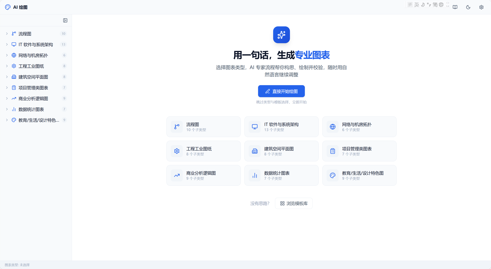
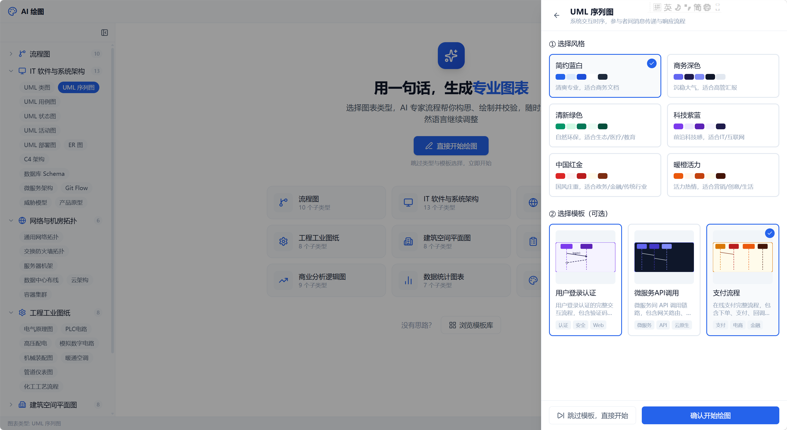
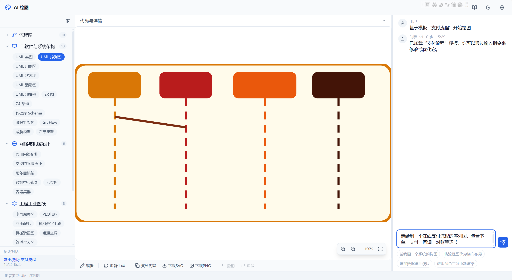
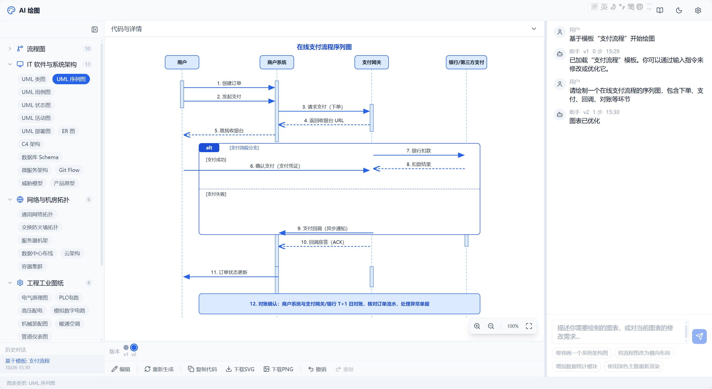
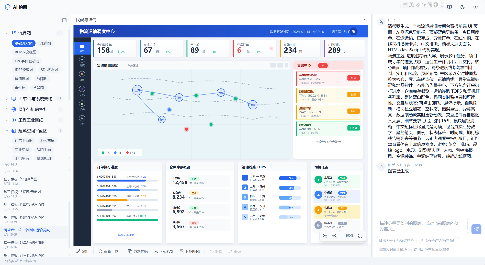
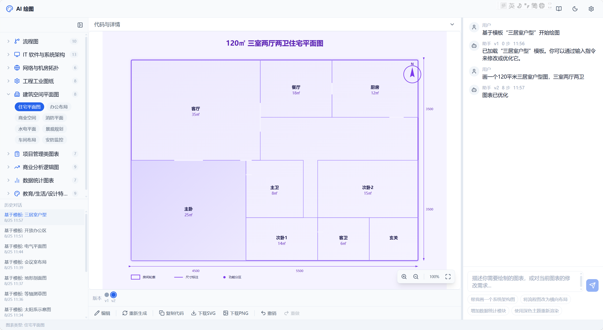
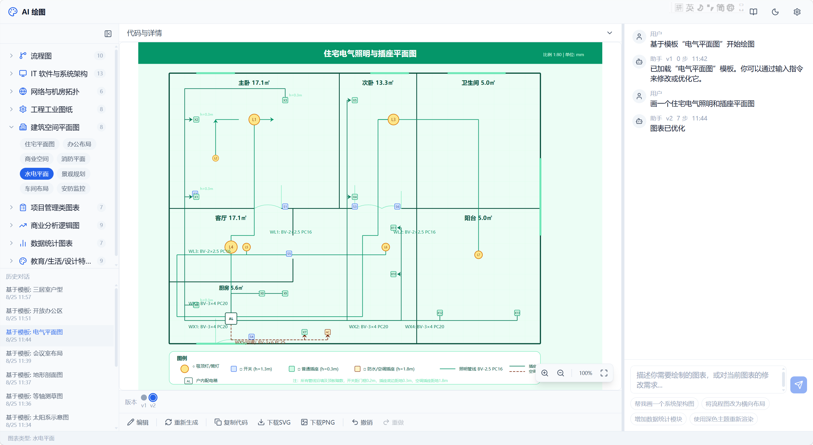
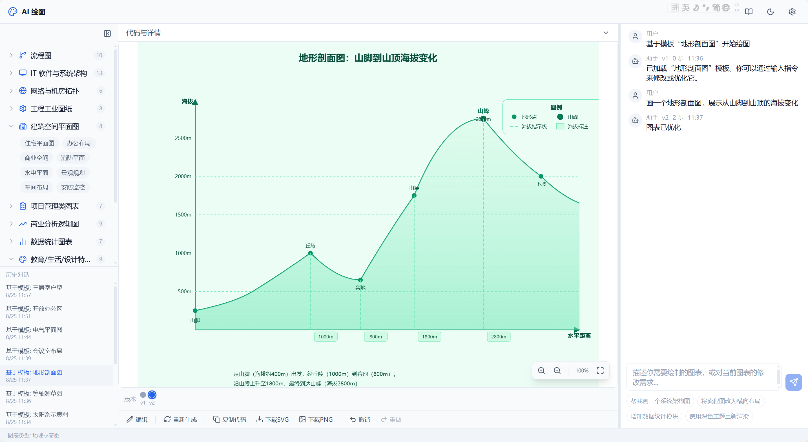
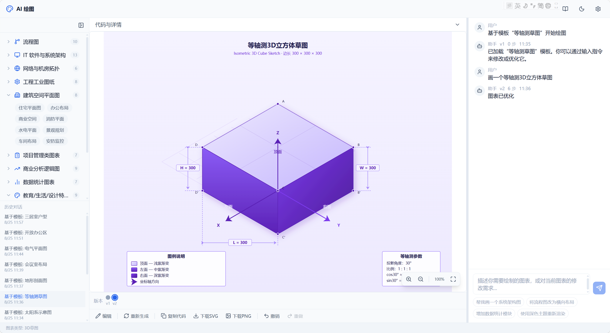
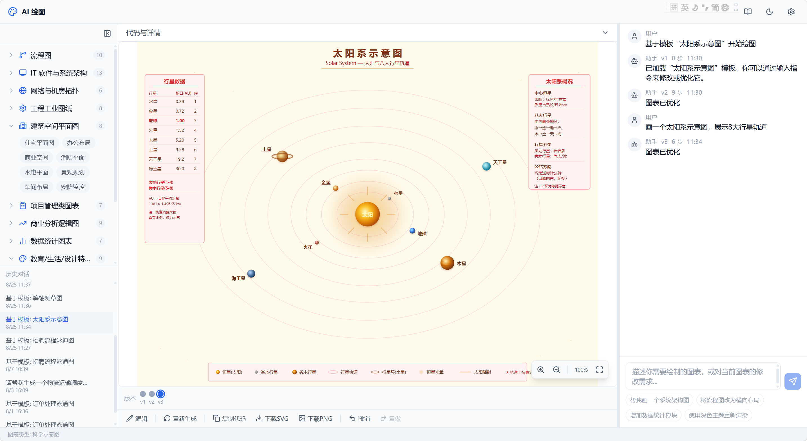

<div align="center">

# AI 绘图 · Draw

**用一句话，生成专业图表**

自然语言描述需求 → AI 专家流程自动构思、绘制并自检 → 秒级产出可编辑、可导出的 SVG 图表

[](https://react.dev/)
[](https://www.typescriptlang.org/)
[](https://vite.dev/)
[](https://tailwindcss.com/)
[](LICENSE)

[功能特性](#-功能特性) · [界面一览](#-界面一览) · [作品示例](#-作品示例) · [快速开始](#-快速开始) · [配置说明](#️-配置说明) · [部署](#-部署) · [项目结构](#-项目结构)

</div>

---

## ✨ 功能特性

| 能力 | 说明 |
| --- | --- |
| 🗂 **9 大类 / 77 种图表** | 流程图、IT 软件与系统架构、网络与机房拓扑、工程工业图纸、建筑空间平面图、项目管理图表、商业分析逻辑图、数据统计图表、教育/生活/设计特色图 |
| 🎨 **160+ 专业模板** | 每个子类型内置可直接套用的场景模板（含结构提示词与示例指令），也可在模板库中检索、预览、一键套用 |
| 🖌 **6 种视觉风格** | 简约蓝白 / 商务深色 / 清新绿色 / 科技紫蓝 / 中国红金 / 暖橙活力 |
| 🧠 **专家流程 + 自检** | 每个分类内置「领域专家」系统提示词与 8 步绘制流程，模型输出后自动执行对齐/溢出/覆盖/连线/箭头/文字/闭合 7 项自检，发现问题自动输出修正版 |
| ⚡ **流式实时预览** | SSE 流式输出，边生成边渲染，实时展示「需求解析 → 流程梳理 → … → 质量检查」进度与自检结果 |
| 💬 **对话式修改** | 右侧对话框持续对话修改图表，支持「改成横向布局」「增加数据统计模块」「用深色主题重新渲染」等自然语言指令，保留多版本历史 |
| 🖌 **SVG 内联编辑器** | 画布上直接选中、拖拽移动节点，双击改文字，右键改填充/描边/线型，支持框选、连线路由重连 |
| ⬇️ **导出** | 一键下载 **SVG**（矢量可二次编辑）或 **PNG**（2x 高清），导出前自动清洗非法 XML |
| 🌗 **深色模式** | 亮/暗主题切换，设置与历史会话本地持久化（localStorage） |
| 🪄 **纯前端** | 无后端服务，React + Vite 单页应用，任意静态托管（Nginx / Vercel / GitHub Pages）即可运行 |

---

## 📸 界面一览

**① 首页 —— 选择图表类型**



**② 选择风格与模板**



**③ 输入指令（支持模板预填与快捷指令）**



**④ 生成结果 —— 流式渲染 + 对话式修改 + 版本管理**



**⑤ 复杂系统 UI 也能一次画出来**



---

## 🎨 作品示例

<table>
<tr>
<td width="50%"><br><sub><b>住宅平面图</b> · 建筑空间平面图</sub></td>
<td width="50%"><br><sub><b>电气照明与插座平面图</b> · 建筑空间平面图</sub></td>
</tr>
<tr>
<td width="50%"><br><sub><b>地形剖面图</b> · 地理示意图</sub></td>
<td width="50%"><br><sub><b>等轴测 3D 立方体草图</b> · 3D 草图</sub></td>
</tr>
<tr>
<td colspan="2"><br><sub><b>太阳系示意图</b> · 科学示意图</sub></td>
</tr>
</table>

---

## 🚀 快速开始

### 环境要求

- Node.js ≥ 20（开发使用 v24）
- npm ≥ 10
- 一个 **OpenAI 兼容** 的大模型 API（Key + Endpoint + 模型名）

### 1. 克隆并安装

```bash
git clone https://github.com/<your-name>/draw.git
cd draw
npm install
```

### 2. 配置环境变量

```bash
cp .env.example .env
```

编辑 `.env`：

```ini
VITE_OPENAI_API_KEY=sk-your-api-key-here
VITE_OPENAI_API_ENDPOINT=https://maas-coding-api.cn-huabei-1.xf-yun.com/v2
VITE_OPENAI_MODEL=gpt-4o
```

> `.env` 已被 `.gitignore` 忽略，**永远不会被提交**。仓库中的 `.env.example` 只含占位符。

### 3. 本地运行

```bash
npm run dev      # 开发模式 http://localhost:5173
npm run build    # 生产构建，产物在 dist/
npm run preview  # 本地预览生产构建
npm run lint     # Oxlint 代码检查
```

> 本地开发时前端一律请求同源 `/api`，由 Vite dev server 代理到目标 API（见 `vite.config.ts`），**无需处理浏览器 CORS**。

---

## ⚙️ 配置说明

| 变量 | 必填 | 说明 |
| --- | --- | --- |
| `VITE_OPENAI_API_KEY` | ✅ | 模型 API Key，缺失时界面会提示并拒绝发起请求 |
| `VITE_OPENAI_API_ENDPOINT` | ✅ | OpenAI 兼容接口地址，需包含 `/v1`、`/v2` 等版本前缀，**末尾不要带斜杠** |
| `VITE_OPENAI_MODEL` | ✅ | 模型名，例如 `gpt-4o`、`gpt-4o-mini`、`GLM-4.6`、`spark-4.0-ultra` |
| `DEV_PROXY_TARGET` | ❌ | 可选。`npm run dev` 时 `/api` 代理的目标地址，默认复用 `VITE_OPENAI_API_ENDPOINT` |

**可用的兼容服务**：OpenAI 官方、讯飞星火（`maas-coding-api.cn-huabei-1.xf-yun.com/v2`）、智谱 GLM、DeepSeek、Kimi、Ollama / vLLM 本地部署等，只要兼容 `/chat/completions` 且支持 `stream: true` 即可。

> ⚠️ **安全提示**：`VITE_*` 变量会被打包进前端 JS，任何访问者都能在浏览器开发者工具中看到。若你的 Key 按量计费且站点公开访问，建议：
> 1. 在 `.env` 中把 `VITE_OPENAI_API_ENDPOINT` 留空，改由 Nginx / 网关在服务端注入 `Authorization` 头；
> 2. 或自建一个极薄的 Node/BFF 中转层，Key 只存在服务端。

---

## 🚢 部署

### 方式一：静态托管（Nginx / 对象存储 / Vercel / GitHub Pages）

```bash
npm run build
# 将 dist/ 上传到服务器 / 推送到托管平台
```

构建产物是 **MPA**：

| 路径 | 内容 |
| --- | --- |
| `/` | 落地页（纯静态 HTML，含 SEO meta / OG / JSON-LD，可被爬虫直接抓取） |
| `/app/` | 绘图应用（React SPA，HashRouter，标记 `noindex`） |
| `/assets/` | JS / CSS 产物（带内容哈希，可长缓存） |

Nginx 配置（含 `/api` 反向代理与 SSE 流式要点）见 **[DEPLOYMENT.md](DEPLOYMENT.md)**。

### 方式二：Node 进程常驻（pm2）

```bash
npm run build
pm2 start ecosystem.config.cjs
pm2 save && pm2 startup
```

---

## 🧩 工作原理

```
用户描述
   │
   ├─ 分类系统提示词（领域专家角色 + 8 步绘制流程 + 7 项自检清单）
   ├─ 选中的视觉风格规范 + （可选）模板的结构提示词
   ▼
LLM 流式输出 [STEP:n] / [CHECK:id] / [SVG_START]…[SVG_END] 标记协议
   │
   ├─ 解析 STEP  → 实时渲染进度条
   ├─ 解析 CHECK → 实时渲染自检结果列表
   └─ 解析 SVG   → 边流边渲染画布（自检不通过时输出修正版并重绘）
   ▼
SVG 预览 / 内联编辑 / 版本切换 / 导出 SVG·PNG
```

关键实现：

| 文件 | 作用 |
| --- | --- |
| `src/services/openai.ts` | SSE 流式请求、增量标记解析、错误分类（Key 失效/额度用尽/限流/上下文超长…） |
| `src/services/svgParser.ts` | 从模型输出中提取 `<svg>`，容错处理被截断的代码 |
| `src/services/export.ts` | 宽松解析 → 合法 XML 清洗 → SVG/PNG 导出（PNG 默认 2x 缩放） |
| `src/components/workspace/SvgEditor.tsx` | SVG 内联编辑器：选中、移动、改文字、改样式、连线路由 |
| `src/data/categories/*.ts` | 9 大类分类体系：专家提示词、绘制步骤、自检项、77 个子类型、160+ 模板 |
| `src/data/styles/index.ts` | 6 套视觉风格预设（色板、字体、线条、圆角） |
| `src/store/appStore.ts` | Zustand 全局状态：设置、会话、版本、编辑器状态 |

---

## 📁 项目结构

```
draw/
├── index.html               # SEO 落地页（根路径，纯静态）
├── app/index.html           # React 应用入口（/app）
├── docs/images/             # README 配图
├── public/                  # favicon / robots.txt / sitemap.xml
├── src/
│   ├── components/
│   │   ├── category/        # 分类树、子类型徽标
│   │   ├── common/          # Button / Modal / Tabs / EmptyState
│   │   ├── layout/          # 顶栏、侧栏、状态栏
│   │   ├── progress/        # 步骤进度、自检结果
│   │   ├── selector/        # 风格与模板选择
│   │   ├── template-library/# 模板库（搜索 / 筛选 / 预览）
│   │   ├── workspace/       # 工作区：画布、聊天、代码、属性面板、SVG 编辑器
│   │   └── settings/        # 设置页、主题切换
│   ├── data/
│   │   ├── categories/      # 9 大类 / 77 子类型 / 160+ 模板
│   │   ├── prompts/         # 基础系统提示词与优化提示词
│   │   └── styles/          # 视觉风格预设
│   ├── hooks/useGeneration.ts
│   ├── services/            # openai / svgParser / export / storage / promptBuilder
│   ├── store/appStore.ts    # Zustand
│   ├── types/ utils/
│   └── main.tsx / App.tsx / index.css
├── DEPLOYMENT.md            # Nginx + SEO 部署文档
└── ecosystem.config.cjs     # pm2 启动配置
```

---

## ❓ 常见问题

**Q：提示「API Key 未配置」？**
A：`.env` 未创建或变量名写错。注意 `.env` 修改后需重启 dev server。

**Q：生成时提示 401 / 429 / 402？**
A：401 = Key 无效；429 = 频率超限，等 1 分钟重试；402 = 额度用尽。

**Q：模型返回的图不准 / 元素重叠？**
A：内置的 7 项自检会要求模型自修正；仍不理想时，用对话补充约束（指定尺寸、方向、配色、必须包含的元素），或直接进入 **SVG 编辑器** 手动调整。

**Q：换模型可以吗？**
A：可以，只要兼容 OpenAI `/chat/completions` 且支持流式输出。图表质量与模型的中文排版和 SVG 生成能力强相关，推荐使用推理/长上下文能力较好的模型。

---

## 🤝 贡献

欢迎提交 Issue 与 PR：

- 新增图表子类型或模板 → `src/data/categories/*.ts`
- 新增视觉风格 → `src/data/styles/index.ts`
- 优化提示词与自检规则 → `src/data/prompts/`、各分类的 `systemPrompt`

提交前请运行：

```bash
npm run lint
npm run build
```

---

## 📄 License

[MIT](LICENSE) © AI 绘图 Contributors

> ⚠️ 免责声明：本项目生成内容由大模型生成，仅供参考，重要场景请人工复核。
